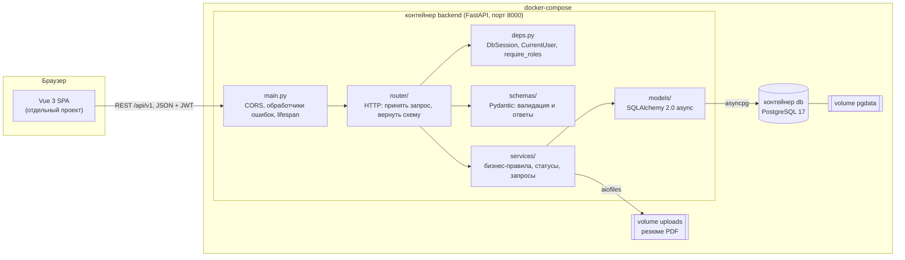
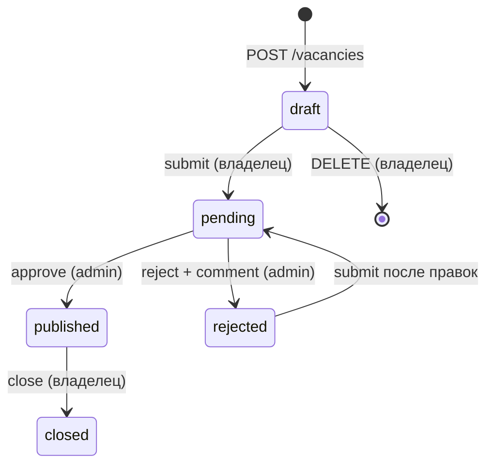

# Архитектура

## Общая схема

## Слои

| Слой | Папка | За что отвечает | Чего в нём нет |
|---|---|---|---|
| HTTP | `app/router/` | путь, метод, роль, код ответа, схема ответа | SQL и бизнес-правил |
| Зависимости | `app/deps.py` | сессия БД на запрос, текущий пользователь по JWT, проверка роли | |
| Валидация | `app/schemas/` | правила для входных данных, форма ответов | обращений к БД |
| Логика | `app/services/` | правила, переходы статусов, проверка владения, запросы к БД, файлы | `HTTPException` (бросает `AppError`) |
| Данные | `app/models/` | таблицы, индексы, CHECK/UNIQUE/FK | |
| Ядро | `app/core/` | настройки, engine и сессии, хеши и JWT, формат ошибок | |

Запрос проходит так: `router` принимает данные, Pydantic-схема их проверяет, `deps` достаёт пользователя,
`router` вызывает функцию из `services`, сервис читает и пишет через `models`, а результат
возвращается как выходная схема `*Read`.

## Жизненный цикл вакансии

Реализован таблицей `ALLOWED_TRANSITIONS` в `app/services/vacancies.py`. Любой другой переход даёт 409.

Редактировать (`PATCH`) можно только в `draft` и `rejected`, удалять только `draft`.

Статус отклика меняется по такой же таблице в `app/services/applications.py`:
`sent → viewed | accepted | rejected`, `viewed → viewed | accepted | rejected`; `accepted` и `rejected` конечные.

## Асинхронность

- Все эндпоинты `async def`, БД только через `AsyncSession` + `asyncpg`.
- Одна сессия на запрос (`get_db`), `expire_on_commit=False`, `autoflush=False`.
- У всех `relationship` стоит `lazy="raise"`; связи грузятся явно (`selectinload` / `joinedload`).
- Argon2 (`hash_password`, `verify_password`) вызывается через `run_in_threadpool`, чтобы не блокировать event loop.
- Резюме читается и пишется чанками по 64 КБ через `aiofiles`.
- В `lifespan` при остановке вызывается `engine.dispose()`. Таблицы создаёт только Alembic.

## Файловое хранилище

Резюме лежат в папке `UPLOAD_DIR` (в Docker это volume `uploads`, смонтированный в `/app/uploads`).
Имя файла на диске всегда `<uuid4>.pdf`. Папка не раздаётся как статика: скачать файл можно только
через `GET /applications/{id}/resume`, где проверяются права.

## Контейнеры

| Сервис | Образ | Что делает |
|---|---|---|
| `db` | `postgres:17-alpine` | БД, healthcheck `pg_isready`, данные в volume `pgdata` |
| `backend` | сборка из `Dockerfile` (python 3.13 + uv) | ждёт `db` (`service_healthy`), выполняет `alembic upgrade head`, запускает `fastapi run` |
| `frontend` | будет добавлен позже | Vue 3 |

## Единый формат ошибок

Все ошибки отдаются как `{"detail": "...", "code": "..."}` (`app/core/exceptions.py`). Для 422
добавляется список `errors` с парами `field` / `message`, чтобы форма на Vue подсветила нужные поля.
Необработанные исключения пишутся в лог и возвращают 500 без трассировки.
