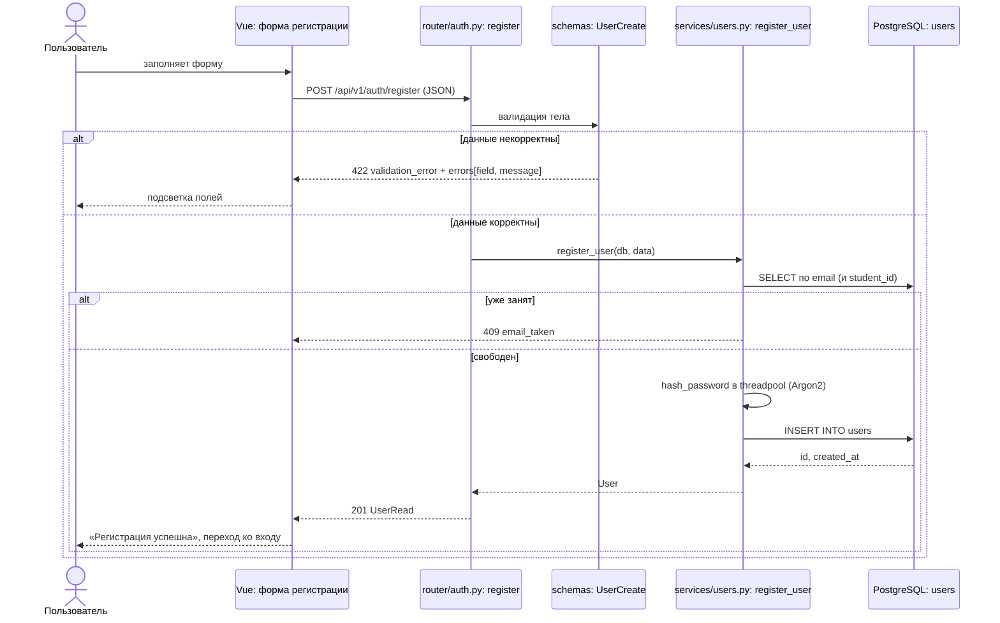
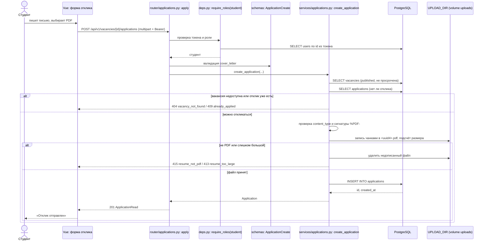

# Потоки данных: что за что отвечает и откуда берутся данные

Для каждого сценария показана цепочка: поле формы на фронте → HTTP-запрос → эндпоинт → схема
валидации → сервис → таблица.колонка → ответ → что показывает интерфейс.

Общие правила для всех сценариев:

- Все пути начинаются с `/api/v1`.
- После входа фронт хранит `access_token` и добавляет заголовок `Authorization: Bearer <token>`.
- Пользователя по токену достаёт `app/deps.py:get_current_user`, роль проверяет `require_roles`.
- Ошибка всегда приходит как `{"detail", "code"}`, а для 422 ещё и `errors[{field, message}]`: по `field` форма подсвечивает нужный input.

## 1. Регистрация

**Запрос:** `POST /auth/register`, JSON. **Эндпоинт:** `app/router/auth.py:register`.
**Схема:** `app/schemas/users.py:UserCreate`. **Сервис:** `app/services/users.py:register_user`.

| Поле формы | Поле JSON | Что делает схема | Куда пишет сервис |
|---|---|---|---|
| Email | `email` | проверяет формат, приводит к нижнему регистру | `users.email` |
| ФИО | `full_name` | схлопывает пробелы, проверяет символы и длину | `users.full_name` |
| Телефон | `phone` | убирает пробелы и дефисы, проверяет формат | `users.phone` |
| Пароль | `password` | длина, буква и цифра | `users.hashed_password` (Argon2-хеш, сам пароль не хранится) |
| Переключатель «Я студент / работодатель» | `role` | запрещает `admin` | `users.role` |
| Курс (виден студенту) | `course` | 1–6, обязателен для студента | `users.course` |
| ID студента (виден студенту) | `student_id` | ровно 7 цифр, необязателен | `users.student_id` |
| Организация (видна работодателю) | `organization` | 2–150, обязательна для работодателя | `users.organization` |
| — | — | — | `users.is_active = true`, `users.created_at = now()` (значения БД) |

Сервис дополнительно проверяет, что email и ID студента не заняты (409 `email_taken` / `student_id_taken`).

**Ответ:** 201, `UserRead` (без `hashed_password`). **Интерфейс:** сообщение об успехе и переход на форму входа;
при 422 подсветка полей по `errors[].field`, при 409 сообщение у поля email.

## 2. Вход

**Запрос:** `POST /auth/login`, `application/x-www-form-urlencoded`. **Эндпоинт:** `app/router/auth.py:login`.
**Схема:** `OAuth2PasswordRequestForm` (FastAPI). **Сервис:** `app/services/users.py:authenticate`.

| Поле формы | Поле запроса | Что делает сервис | Откуда данные |
|---|---|---|---|
| Email или ID студента | `username` | 7 цифр ищет по `users.student_id`, иначе по `users.email` (`get_user_by_login`) | `users` |
| Пароль | `password` | сверяет с Argon2-хешем в threadpool; для несуществующего логина сверяет с dummy-хешем | `users.hashed_password` |
| — | — | проверяет `users.is_active` | `users.is_active` |

**Ответ:** 200, `{"access_token": "<JWT>", "token_type": "bearer"}`. В токене `sub` = `users.id` и `exp`
(`app/core/security.py:create_access_token`, HS256, ключ `SECRET_KEY`).
При ошибке 401 `invalid_credentials` с одинаковым текстом «Неверный логин или пароль».

**Интерфейс:** сохраняет токен, запрашивает `GET /users/me` (`app/router/users.py:read_me`) и по `role`
показывает кабинет студента, работодателя или администратора.

## 3. Создание вакансии

**Запрос:** `POST /vacancies`, JSON, роль `employer`. **Эндпоинт:** `app/router/vacancies.py:create_vacancy`.
**Схема:** `app/schemas/vacancies.py:VacancyCreate`. **Сервис:** `app/services/vacancies.py:create_vacancy`.

| Поле формы | Поле JSON | Что делает схема | Колонка |
|---|---|---|---|
| Название | `title` | 5–150 | `vacancies.title` |
| Описание | `description` | 30–5000 | `vacancies.description` |
| Требования | `requirements` | до 3000 | `vacancies.requirements` |
| Категория (select из `GET /categories`) | `category_id` | целое; существование проверяет сервис | `vacancies.category_id` |
| Тип занятости | `employment_type` | enum | `vacancies.employment_type` |
| Город | `location` | 2–100 | `vacancies.location` |
| Чекбокс «Удалённо» | `is_remote` | boolean | `vacancies.is_remote` |
| Зарплата от / до | `salary_min`, `salary_max` | границы, `min <= max` | `vacancies.salary_min`, `vacancies.salary_max` |
| Валюта | `currency` | `UZS` / `USD` | `vacancies.currency` |
| Для какого курса | `target_course` | 1–6 | `vacancies.target_course` |
| Контактный email | `contact_email` | формат email | `vacancies.contact_email` |
| Дедлайн | `deadline` | в будущем, не дальше 365 дней | `vacancies.deadline` |
| — | — | — | `vacancies.employer_id` = id из токена, `vacancies.status = draft`, `created_at`, `updated_at` |

**Ответ:** 201, `VacancyRead` с вложенными `category` (`categories`) и `employer` (`users`: id, ФИО, организация).
**Интерфейс:** вакансия появляется в «Моих вакансиях» (`GET /vacancies/my`) со статусом «Черновик» и кнопками
«Изменить», «Удалить», «Отправить на модерацию».

Отправка на модерацию: `POST /vacancies/{id}/submit` → `app/router/vacancies.py:submit_vacancy` →
`app/services/vacancies.py:submit_vacancy` → `vacancies.status = pending`.

## 4. Модерация

| Шаг | Запрос | Эндпоинт | Сервис | Что меняется в БД | Что видит интерфейс |
|---|---|---|---|---|---|
| Очередь | `GET /admin/vacancies?status=pending` | `app/router/admin.py:list_vacancies_for_moderation` | `vacancies.py:list_for_admin` | чтение `vacancies` + `categories` + `users` | таблица вакансий на проверке (`items`, `total`) |
| Одобрить | `POST /admin/vacancies/{id}/approve` | `admin.py:approve_vacancy` | `vacancies.py:approve_vacancy` | `status = published`, `published_at = now`, `moderation_comment = null` | вакансия уходит из очереди и появляется в публичной ленте |
| Отклонить | `POST /admin/vacancies/{id}/reject`, JSON `{"comment"}` | `admin.py:reject_vacancy`, схема `VacancyReject` | `vacancies.py:reject_vacancy` | `status = rejected`, `moderation_comment = comment` | у работодателя статус «Отклонена» и текст комментария |

Поле формы «Причина отклонения» → `comment` → `vacancies.moderation_comment`.
Допустимость перехода проверяет `_change_status` по таблице `ALLOWED_TRANSITIONS`; иначе 409 `invalid_status_transition`.
После правок (`PATCH /vacancies/{id}`) работодатель снова вызывает `submit`.

Публичная лента `GET /vacancies` (`app/router/vacancies.py:list_vacancies`, схема `VacancyFilter`,
сервис `list_published`) показывает только `status = published` и `deadline >= сегодня`.

## 5. Отклик с резюме

**Запрос:** `POST /vacancies/{id}/applications`, `multipart/form-data`, роль `student`.
**Эндпоинт:** `app/router/applications.py:apply`. **Схема:** `app/schemas/applications.py:ApplicationCreate`.
**Сервис:** `app/services/applications.py:create_application`.

| Поле формы | Часть запроса | Проверка | Куда попадает |
|---|---|---|---|
| — | `vacancy_id` в пути | вакансия `published` и не просрочена (сервис) | `applications.vacancy_id` |
| — | токен | роль `student` (`require_roles`) | `applications.student_id` |
| Сопроводительное письмо | `cover_letter` | 20–2000, если заполнено (схема) | `applications.cover_letter` |
| Файл резюме | `resume` | `content_type`, сигнатура `%PDF-`, размер (сервис `_save_resume`) | файл `UPLOAD_DIR/<uuid4>.pdf`; имя файла в `applications.resume_path` |
| — | имя файла от клиента | очищается (`clean_filename`) | `applications.resume_original_name` |
| — | — | — | `applications.status = sent`, `created_at = now()` |

**Ответ:** 201, `ApplicationRead` (`has_resume` вместо пути к файлу).
**Интерфейс студента:** отклик в «Моих откликах» (`GET /applications/my`) со статусом «Отправлен».
**Интерфейс работодателя:** отклик в списке `GET /vacancies/{id}/applications` с контактами студента;
кнопка «Резюме» вызывает `GET /applications/{id}/resume` (`applications.py:download_resume` → `get_resume` → `FileResponse`);
кнопки «Просмотрен / Принять / Отказать» вызывают `PATCH /applications/{id}/status`.

## Статистика (дополнительно)

`GET /admin/stats` → `app/router/admin.py:read_stats` → `app/services/stats.py:get_admin_stats`.
Все числа считает PostgreSQL:

| Поле ответа | Источник |
|---|---|
| `vacancies_by_status`, `vacancies_total` | `SELECT status, count(*) FROM vacancies GROUP BY status` |
| `applications_total` | `SELECT count(*) FROM applications` |
| `top_categories` | `categories JOIN vacancies JOIN applications`, `GROUP BY` категория, `ORDER BY count DESC LIMIT 5` |
| `applications_by_day` | `generate_series` за 14 дней `LEFT JOIN applications` по дате `created_at`, `GROUP BY` день |
