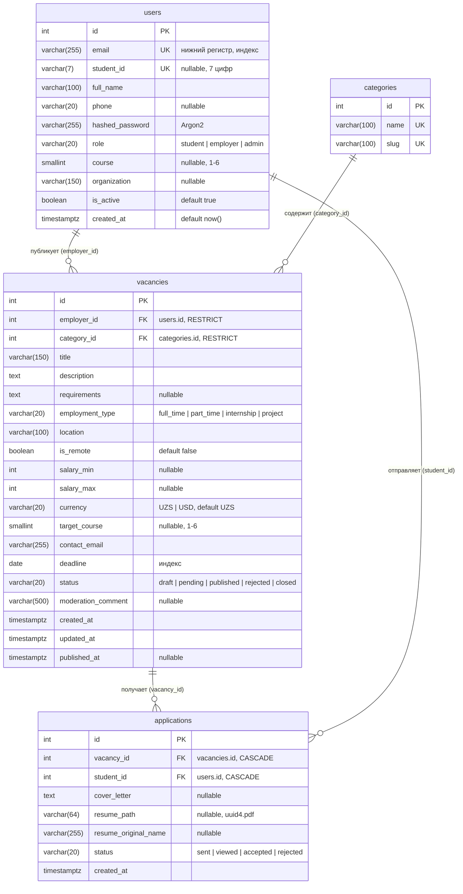

# ER-диаграмма

Диаграмма построена по реальным моделям из `app/models/` (схема создаётся миграциями Alembic).

## Таблицы

### users (`app/models/users.py`)
Все учётные записи: студенты, работодатели (сотрудники университета) и администраторы. Роль хранится
в `role`. `course` заполняется только у студентов, `organization` только у работодателей.
`student_id` — необязательный 7-значный ID студента в университете, по нему можно входить вместо email.
Пароль хранится только как Argon2-хеш в `hashed_password`.

Ограничения: `uq_users_student_id`, уникальный индекс `ix_users_email`,
`ck_users_course_range` (1–6), `ck_users_email_lowercase`, `ck_users_student_id_format` (7 цифр),
`ck_users_role`.

### categories (`app/models/categories.py`)
Справочник категорий вакансий. `name` и `slug` уникальны.

### vacancies (`app/models/vacancies.py`)
Вакансия принадлежит работодателю (`employer_id`) и категории (`category_id`). Оба внешних ключа
`RESTRICT`: нельзя удалить пользователя или категорию, пока есть их вакансии. Жизненный цикл
задаётся полем `status`, комментарий модератора при отклонении лежит в `moderation_comment`.

Индексы: `ix_vacancies_status_category_id (status, category_id)` для публичной ленты,
`ix_vacancies_deadline`, `ix_vacancies_employer_id`.
CHECK: `ck_vacancies_salary_range` (`salary_min <= salary_max`, если оба заданы),
`ck_vacancies_salary_non_negative`, `ck_vacancies_target_course_range` (1–6),
`ck_vacancies_employment_type`, `ck_vacancies_currency`, `ck_vacancies_status`.

### applications (`app/models/applications.py`)
Отклик студента на вакансию. Внешние ключи `CASCADE`: отклики удаляются вместе с вакансией или
студентом. `uq_applications_vacancy_student (vacancy_id, student_id)` запрещает повторный отклик.
`resume_path` хранит только имя файла на диске (`<uuid4>.pdf` в `UPLOAD_DIR`), исходное имя файла
от клиента лежит отдельно в `resume_original_name` и на диск не попадает.

Индекс: `ix_applications_student_id`. CHECK: `ck_applications_status`.

## Общие правила

- Время хранится как `timestamptz` в UTC, `created_at` проставляет сервер БД (`now()`).
- Enum'ы хранятся как `varchar` + CHECK (`native_enum=False`), а не как типы PostgreSQL: так проще мигрировать.
- Имена индексов и ограничений задаёт `naming_convention` в `app/core/db.py`.
