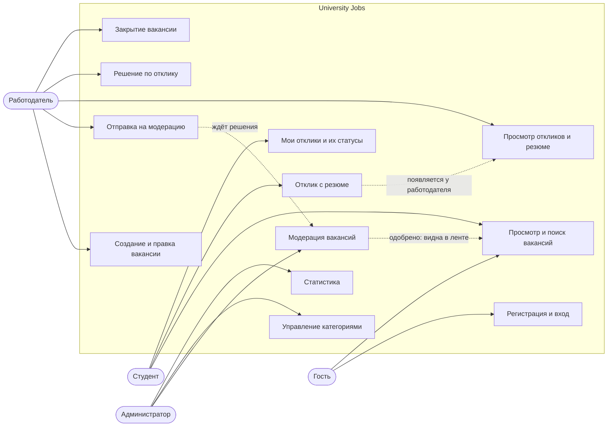

# Сценарии использования

## Акторы

| Актор | Роль в системе | Как появляется |
|---|---|---|
| Гость | без токена | любой посетитель |
| Студент | `student` | регистрация через API |
| Работодатель (сотрудник университета или компания) | `employer` | регистрация через API |
| Администратор (модератор) | `admin` | только `scripts/seed.py` |

## Диаграмма

## Актор → сценарий → эндпоинт

Все пути с префиксом `/api/v1`.

| Актор | Сценарий | Эндпоинт |
|---|---|---|
| Гость | Зарегистрироваться студентом или работодателем | `POST /auth/register` |
| Гость | Войти по email или ID студента | `POST /auth/login` |
| Гость | Посмотреть ленту вакансий, искать и фильтровать | `GET /vacancies` |
| Гость | Открыть опубликованную вакансию | `GET /vacancies/{id}` |
| Гость | Получить список категорий для фильтра | `GET /categories` |
| Любой авторизованный | Посмотреть и изменить свой профиль | `GET /users/me`, `PATCH /users/me` |
| Студент | Откликнуться на вакансию с письмом и PDF-резюме | `POST /vacancies/{id}/applications` |
| Студент | Следить за статусами своих откликов | `GET /applications/my` |
| Студент | Скачать своё резюме из отклика | `GET /applications/{id}/resume` |
| Работодатель | Создать черновик вакансии | `POST /vacancies` |
| Работодатель | Посмотреть свои вакансии во всех статусах | `GET /vacancies/my` |
| Работодатель | Исправить черновик или отклонённую вакансию | `PATCH /vacancies/{id}` |
| Работодатель | Удалить черновик | `DELETE /vacancies/{id}` |
| Работодатель | Отправить вакансию на модерацию | `POST /vacancies/{id}/submit` |
| Работодатель | Закрыть опубликованную вакансию | `POST /vacancies/{id}/close` |
| Работодатель | Посмотреть отклики на свою вакансию | `GET /vacancies/{id}/applications` |
| Работодатель | Скачать резюме кандидата | `GET /applications/{id}/resume` |
| Работодатель | Отметить отклик просмотренным, принять или отказать | `PATCH /applications/{id}/status` |
| Администратор | Посмотреть очередь модерации | `GET /admin/vacancies?status=pending` |
| Администратор | Одобрить вакансию | `POST /admin/vacancies/{id}/approve` |
| Администратор | Отклонить вакансию с комментарием | `POST /admin/vacancies/{id}/reject` |
| Администратор | Вести справочник категорий | `POST /categories`, `PATCH /categories/{id}`, `DELETE /categories/{id}` |
| Администратор | Посмотреть статистику | `GET /admin/stats` |
| Администратор | Найти пользователя, заблокировать или разблокировать его | `GET /admin/users`, `PATCH /admin/users/{id}/active` |
| Администратор | Посмотреть все отклики и скачать резюме | `GET /admin/applications`, `GET /applications/{id}/resume` |
| Мониторинг | Проверить сервис и БД | `GET /health` |

## Правила доступа

- Неподходящая роль получает 403 (`role_forbidden`).
- Чужой ресурс (чужая вакансия, чужой отклик, чужое резюме) отдаётся как 404, чтобы не раскрывать его существование.
- Без токена или с плохим токеном ответ 401 с заголовком `WWW-Authenticate: Bearer`.
- `target_course` у вакансии служит только фильтром и подсказкой: студент другого курса тоже может откликнуться.
